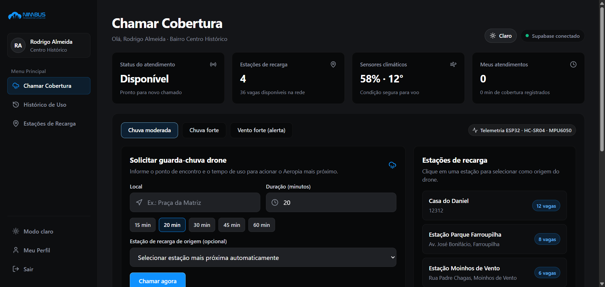
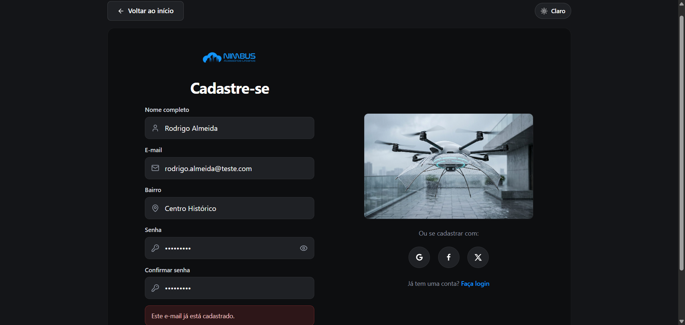
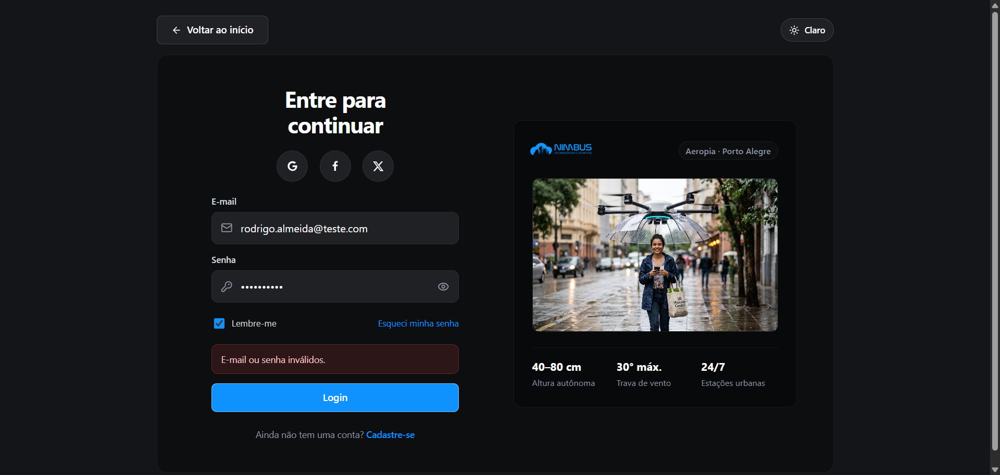
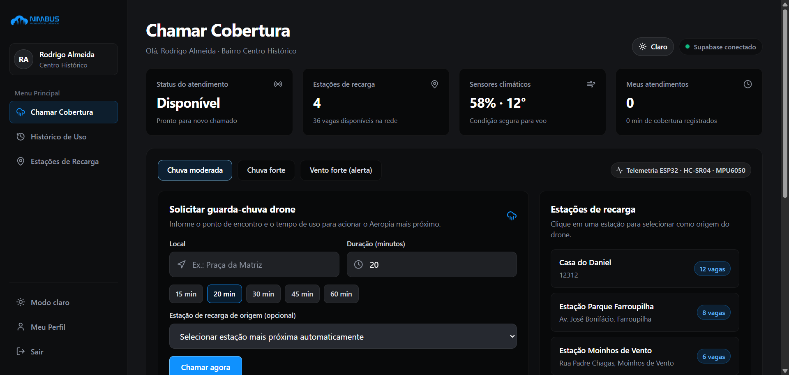
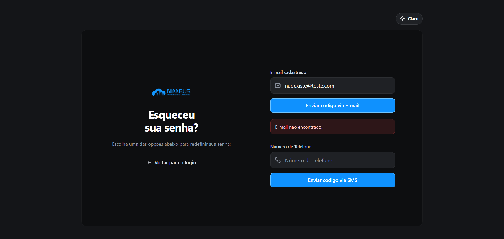
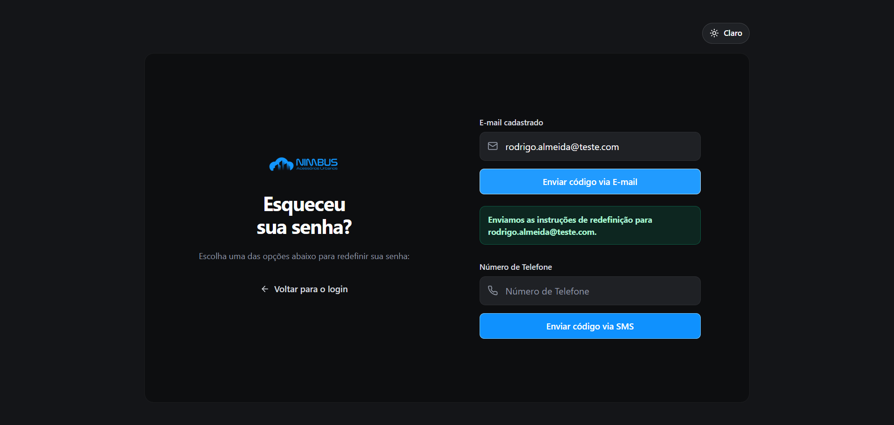
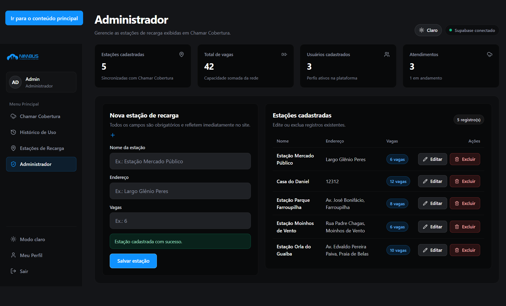
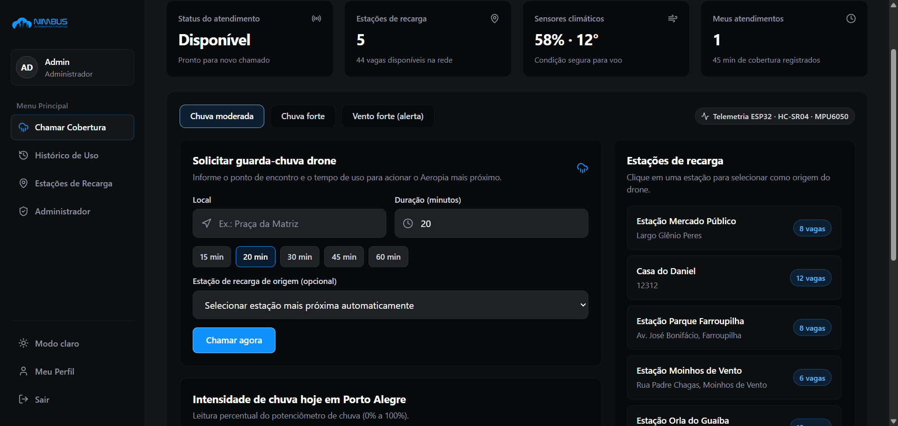
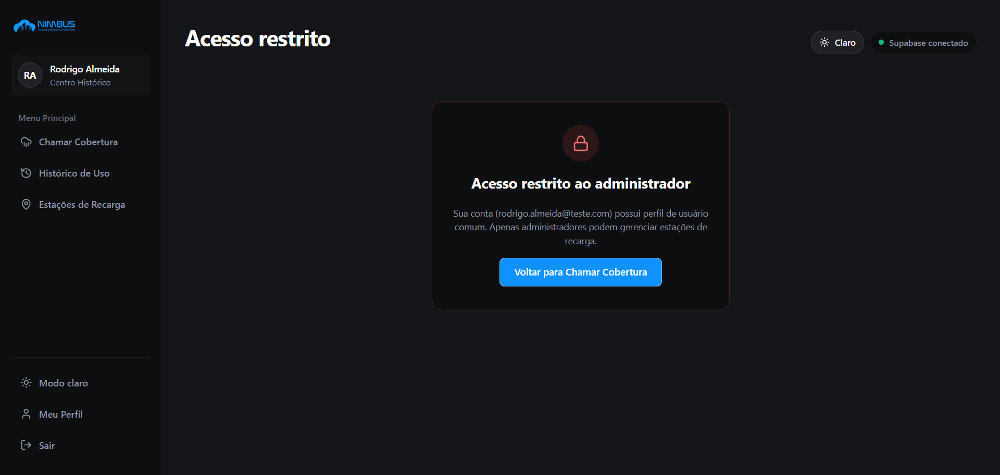
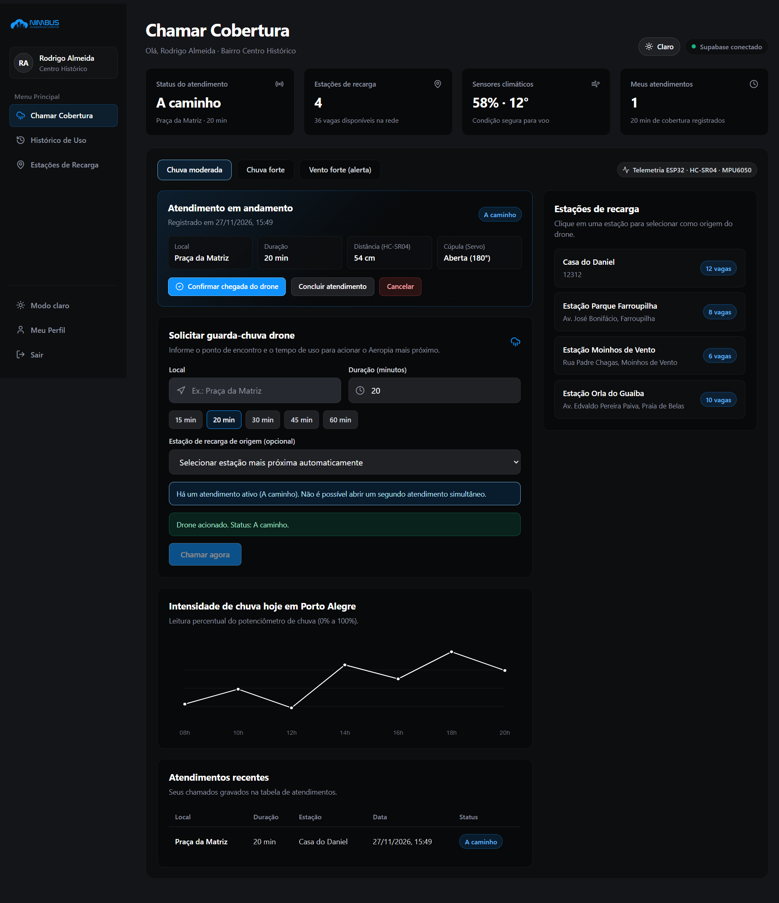

**PROJETO INTEGRADOR — FÁBRICA DO FUTURO**

**Casos de teste · Modelo para preenchimento**

**Identificação**

| Nome comercial do produto | Aeropia (Nimbus Aeropia) |
| :---- | :---- |
| **Projeto do catálogo** | Projeto 08 — Guarda-chuva Drone |
| **Endereço do site testado** | http://localhost:5174 (integrado ao Supabase) |
| **Data da execução** | 27/11/2026 |

 

| Status | Quando usar |
| :---- | :---- |
| Aprovado | O resultado obtido é igual ao esperado. |
| Reprovado | O resultado obtido é diferente do esperado. Descrevam o defeito. |
| Bloqueado | Não foi possível executar o teste. Expliquem o motivo. |

 

**Resumo**

| CT | Página | Status | Tester |
| :---- | :---- | :---- | :---- |
| CT-01 | Cadastro | Aprovado | Matheus Quirino |
| CT-02 | Login | Aprovado | Matheus Quirino |
| CT-03 | Redefinição de senha | Aprovado | Matheus Quirino |
| CT-04 | Administrador | Aprovado | Matheus Quirino |
| CT-05 | Funcionalidade (Chamar Cobertura) | Aprovado | Matheus Quirino |

 

| CT-01     Cadastro de usuário com dados válidos |  |
| :---- | :---- |
| **ELABORADO PELA FÁBRICA DO FUTURO** |  |
| **Funcionalidade** | Registro de usuários |
| **Página** | Cadastro |
| **Requisito relacionado** | RF01, RNF01 |
| **Objetivo** | Verificar se o cadastro grava o usuário no banco, incluindo o campo Bairro. |
| **Pré-condições** | O e-mail rodrigo.almeida@teste.com ainda não está cadastrado. |
| **Massa de dados** | Nome: Rodrigo Almeida. E-mail: rodrigo.almeida@teste.com. Senha: Teste@123. Bairro: Centro Histórico. |
| **Passo a passo** | 1. Abrir a página de Cadastro. 2. Preencher os campos com a massa de dados. 3. Clicar em Cadastrar. 4. Abrir a tabela de usuários no banco e localizar o e-mail cadastrado. |
| **Resultado esperado** | A plataforma confirma o cadastro. O banco tem um registro novo com nome, e-mail e Bairro = Centro Histórico. A senha está gravada como hash, e não como Teste@123. Repetir o cadastro com o mesmo e-mail é recusado. |
| **PREENCHIDO PELO TESTER** |  |
| **Resultado obtido** | Cadastro concluído com sucesso em `/cadastro` e sessão autenticada no Supabase, redirecionando para `/dashboard` com identificação `"Rodrigo Almeida"` e `"Centro Histórico"` (`"Olá, Rodrigo Almeida · Bairro Centro Histórico"`). Na tabela `public.profiles` do Supabase, foi gravado o registro `id: fe2f2665-e752-42a6-82bd-50869a9001cb`, `nome: "Rodrigo Almeida"`, `email: "rodrigo.almeida@teste.com"`, `bairro: "Centro Histórico"`, `role: "user"`, sem armazenar senha em texto plano (autenticação e hash bcrypt gerenciados pelo Supabase Auth em `auth.users`). Ao repetir o cadastro com `rodrigo.almeida@teste.com`, a tentativa foi recusada (HTTP 422) com a mensagem `"Este e-mail já está cadastrado."`. |
| **Status** | ☑ Aprovado        ☐ Reprovado        ☐ Bloqueado |
| **Evidências** | Capturas da tela após o cadastro (`evidencias/CT-01-cadastro-sucesso.png`), recusa de e-mail duplicado (`evidencias/CT-01-email-duplicado.png`) e conferência do registro na tabela `public.profiles` do Supabase. |
| **Observações do Tester** | O sistema opera com autenticação nativa do Supabase Auth (que grava o hash da senha em `auth.users.encrypted_password`) e trigger `handle_new_user` gravando `nome`, `email`, `bairro` e `role` em `public.profiles`. |
| **Tester e data** | Matheus Quirino · 27/11/2026 |

 

|   |
| :---: |

| CT-02     Login com senha errada e com senha correta |  |
| :---- | :---- |
| **ELABORADO PELA FÁBRICA DO FUTURO** |  |
| **Funcionalidade** | Autenticação |
| **Página** | Login |
| **Requisito relacionado** | RF02 |
| **Objetivo** | Verificar se o login recusa a senha errada e aceita a correta. |
| **Pré-condições** | Usuário do CT-01 cadastrado. Navegador sem sessão iniciada. |
| **Massa de dados** | E-mail: rodrigo.almeida@teste.com. Senha errada: Errada@999. Senha correta: Teste@123. |
| **Passo a passo** | 1. Abrir a página de Login. 2. Informar o e-mail com a senha errada e clicar em Entrar. 3. Observar a mensagem. 4. Informar o e-mail com a senha correta e clicar em Entrar. |
| **Resultado esperado** | Com a senha errada, o login é recusado com mensagem que não revela qual campo está errado. Com a senha correta, a plataforma abre a área interna identificando Rodrigo Almeida, sem o item Administrador no menu. |
| **PREENCHIDO PELO TESTER** |  |
| **Resultado obtido** | Sem sessão iniciada em `/login`, ao informar `rodrigo.almeida@teste.com` e senha `Errada@999`, o login foi recusado (HTTP 400) exibindo a mensagem genérica `"E-mail ou senha inválidos."`, sem revelar qual campo estava incorreto. Ao informar a senha correta `Teste@123`, a plataforma autenticou e abriu `/dashboard` identificando `"Rodrigo Almeida"` (`"Centro Histórico"`) no menu lateral e `"Olá, Rodrigo Almeida · Bairro Centro Histórico"` no cabeçalho, exibindo apenas os itens `Chamar Cobertura`, `Histórico de Uso`, `Estações de Recarga`, `Meu Perfil` e `Sair` — sem o item `Administrador`. |
| **Status** | ☑ Aprovado        ☐ Reprovado        ☐ Bloqueado |
| **Evidências** | Capturas da recusa com senha errada (`evidencias/CT-02-senha-errada.png`) e do acesso à área interna sem o item Administrador (`evidencias/CT-02-login-sucesso.png`). |
| **Observações do Tester** | — |
| **Tester e data** | Matheus Quirino · 27/11/2026 |

 

|   |
| :---: |

| CT-03     Redefinição de senha |  |
| :---- | :---- |
| **ELABORADO PELA FÁBRICA DO FUTURO** |  |
| **Funcionalidade** | Recuperação de acesso |
| **Página** | Redefinição de senha |
| **Requisito relacionado** | RF03 |
| **Objetivo** | Verificar se a redefinição confirma o envio para e-mail cadastrado e avisa quando o e-mail não existe. |
| **Pré-condições** | Usuário do CT-01 cadastrado. Navegador sem sessão iniciada. |
| **Massa de dados** | E-mail não cadastrado: naoexiste@teste.com. E-mail cadastrado: rodrigo.almeida@teste.com. |
| **Passo a passo** | 1. Abrir a página de Login e clicar em Esqueci minha senha. 2. Informar naoexiste@teste.com e enviar. 3. Observar a mensagem. 4. Informar rodrigo.almeida@teste.com e enviar. |
| **Resultado esperado** | Para o e-mail não cadastrado, a plataforma avisa que o e-mail não foi encontrado. Para rodrigo.almeida@teste.com, confirma que as instruções foram enviadas. No Supabase, o e-mail chega à caixa de entrada; no PHP, o pedido fica registrado no banco. |
| **PREENCHIDO PELO TESTER** |  |
| **Resultado obtido** | Após clicar em `"Esqueci minha senha"` (`/esqueceu-senha`), ao enviar `naoexiste@teste.com`, a plataforma exibiu o alerta `"E-mail não encontrado."`. Ao enviar `rodrigo.almeida@teste.com`, a plataforma exibiu a confirmação `"Enviamos as instruções de redefinição para rodrigo.almeida@teste.com."` e registrou a solicitação na tabela `public.redefinicoes_senha` do Supabase (`id: 2909c47c-a76b-4773-ad43-978cb6bc4475`, `canal: "email"`). |
| **Status** | ☑ Aprovado        ☐ Reprovado        ☐ Bloqueado |
| **Evidências** | Capturas da mensagem de e-mail não encontrado (`evidencias/CT-03-email-nao-encontrado.png`), da confirmação de envio (`evidencias/CT-03-redefinicao-enviada.png`) e do registro na tabela `public.redefinicoes_senha`. |
| **Observações do Tester** | O envio pela API `resetPasswordForEmail` do Supabase foi aceito e registrado em `public.redefinicoes_senha`; a entrega na caixa de entrada externa não foi inspecionada por se tratar de domínio fictício de teste (`@teste.com`). |
| **Tester e data** | Matheus Quirino · 27/11/2026 |

 

|   |
| :---: |

| CT-04     Administrador: gerenciar estação de recarga e bloquear usuário comum |  |
| :---- | :---- |
| **ELABORADO PELA FÁBRICA DO FUTURO** |  |
| **Funcionalidade** | Gerenciamento de estação de recarga e controle de acesso |
| **Página** | Administrador |
| **Requisito relacionado** | RF04 |
| **Objetivo** | Verificar se o administrador cadastra, edita e exclui estação de recarga e se o usuário comum não acessa a página. |
| **Pré-condições** | Usuário administrador cadastrado. Usuário Rodrigo Almeida do CT-01, que é comum. |
| **Massa de dados** | Nome: Estação Mercado Público. Endereço: Largo Glênio Peres. Vagas: 6. |
| **Passo a passo** | 1. Entrar como administrador e abrir a página de Administrador. 2. Cadastrar com a massa de dados e salvar. 3. Editar o registro, alterando o número de vagas para 8, e salvar. 4. Conferir o registro em: lista de estações exibida na página Chamar Cobertura. 5. Excluir o registro e confirmar. 6. Sair, entrar como Rodrigo Almeida e digitar na barra de endereço o caminho da página de Administrador. |
| **Resultado esperado** | O registro aparece na lista e em lista de estações exibida na página Chamar Cobertura; a edição é gravada; a exclusão o remove dos dois lugares. Campos obrigatórios (nome, endereço e vagas) vazios são recusados. Logado como usuário comum, a página de Administrador é bloqueada e nenhum dado administrativo aparece. |
| **PREENCHIDO PELO TESTER** |  |
| **Resultado obtido** | Logado como `admin@nimbus.com`, ao tentar salvar sem preencher campos, os três campos obrigatórios foram recusados com `"Informe o nome da estação de recarga."`, `"Informe o endereço da estação."` e `"Informe um número inteiro de vagas maior que zero."`. Ao cadastrar `Estação Mercado Público` (`Largo Glênio Peres`, `6` vagas), exibiu `"Estação cadastrada com sucesso."` e incluiu o item na lista. Ao editar para `8` vagas, exibiu `"Estação atualizada com sucesso."` e refletiu `8 vagas` tanto no `/admin` quanto na lista de estações e no seletor da página `Chamar Cobertura` (`/dashboard`). Ao excluir e confirmar, exibiu `"Estação excluída com sucesso."` e o registro foi removido de `/admin`, de `Chamar Cobertura` e da tabela `public.estacoes_recarga` no Supabase. Logado como `rodrigo.almeida@teste.com` e acessando `/admin` pela barra de endereços, a página exibiu `"Acesso restrito ao administrador"` sem expor nenhum dado administrativo. |
| **Status** | ☑ Aprovado        ☐ Reprovado        ☐ Bloqueado |
| **Evidências** | Capturas do cadastro (`evidencias/CT-04-estacao-criada.png`), edição (`evidencias/CT-04-estacao-editada.png`), exibição em Chamar Cobertura (`evidencias/CT-04-estacao-dashboard.png`), exclusão (`evidencias/CT-04-estacao-excluida.png`) e bloqueio do usuário comum (`evidencias/CT-04-bloqueio-usuario-comum.png`). |
| **Observações do Tester** | — |
| **Tester e data** | Matheus Quirino · 27/11/2026 |

 

|    |
| :---: |

| CT-05     Chamar Cobertura: ação principal do produto |  |
| :---- | :---- |
| **ELABORADO PELA FÁBRICA DO FUTURO** |  |
| **Funcionalidade** | A pessoa solicita o drone e acompanha o status do atendimento. |
| **Página** | Funcionalidade (Chamar Cobertura) |
| **Requisito relacionado** | RF05 |
| **Objetivo** | Verificar se a ação principal do produto grava e exibe corretamente os dados informados. |
| **Pré-condições** | Login feito como Rodrigo Almeida. |
| **Massa de dados** | Local: Praça da Matriz. Duração: 20 minutos. |
| **Passo a passo** | 1. Abrir a página Chamar Cobertura. 2. Informar o local Praça da Matriz e a duração de 20 minutos. 3. Clicar em Chamar agora. 4. Conferir o atendimento com o status A caminho na tela e na tabela de atendimentos do banco. |
| **Resultado esperado** | O atendimento é gravado com local, duração, data e status A caminho, vinculado à pessoa logada. Não é possível abrir um segundo atendimento enquanto houver um em andamento. |
| **PREENCHIDO PELO TESTER** |  |
| **Resultado obtido** | Logado como Rodrigo Almeida em `/dashboard` (`Chamar Cobertura`), após informar local `Praça da Matriz` e duração `20` minutos e clicar em `"Chamar agora"`, a plataforma exibiu `"Drone acionado. Status: A caminho."`. O card `"Atendimento em andamento"` e a tabela `"Atendimentos recentes"` exibiram local `Praça da Matriz`, duração `20 min`, data `27/11/2026, 15:49` e status `A caminho`. Na tabela `public.atendimentos` do Supabase, confirmou-se o registro `id: 0cb5e2ec-84d1-4575-8a0f-01d4311d475d`, `user_id: fe2f2665-e752-42a6-82bd-50869a9001cb`, `local: "Praça da Matriz"`, `duracao_minutos: 20`, `status: "A caminho"`. Enquanto ativo, o formulário exibiu o alerta `"Há um atendimento ativo (A caminho). Não é possível abrir um segundo atendimento simultâneo."` e manteve o botão `"Chamar agora"` desabilitado. |
| **Status** | ☑ Aprovado        ☐ Reprovado        ☐ Bloqueado |
| **Evidências** | Captura completa da tela `Chamar Cobertura` com atendimento `A caminho` e bloqueio de novo chamado (`evidencias/CT-05-chamar-cobertura.png`) e conferência do registro na tabela `public.atendimentos` do Supabase. |
| **Observações do Tester** | — |
| **Tester e data** | Matheus Quirino · 27/11/2026 |

 

|  |
| :---: |
